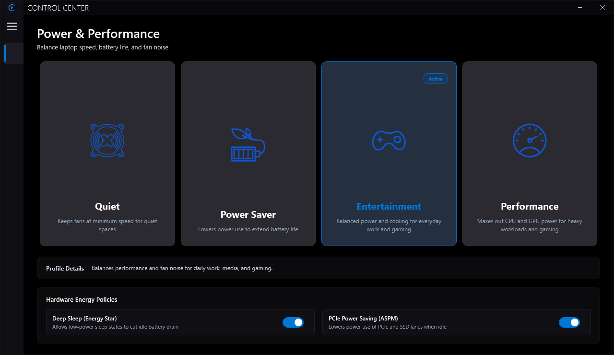
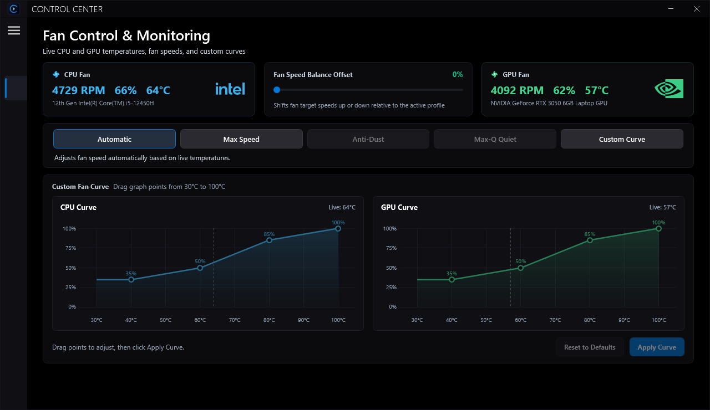
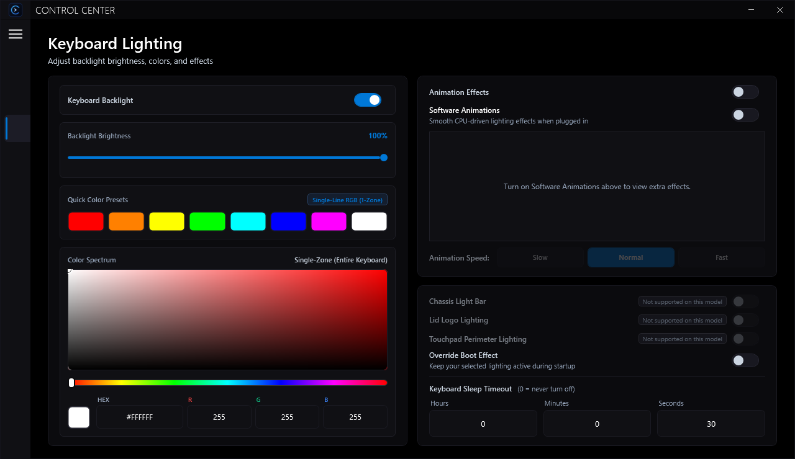
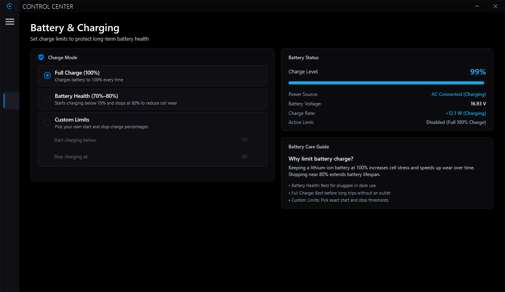
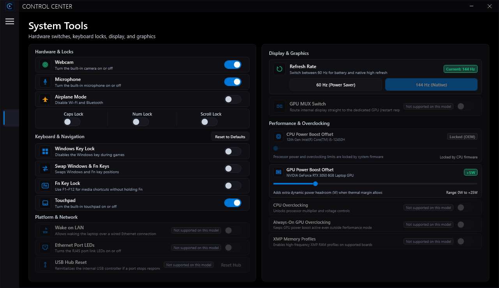
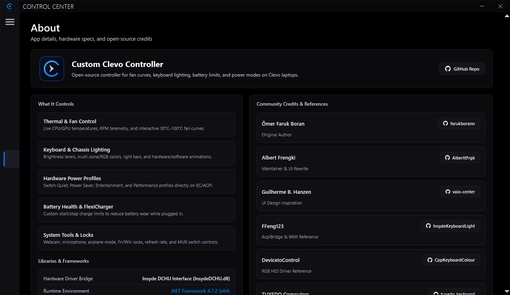

# CustomClevoController

Open-source control center for Clevo and ODM laptops (Sager, Schenker, XMG, System76, and compatible chassis). Replaces OEM Control Center 3.0 to manage fan curves, power profiles, battery charge limits, and keyboard backlighting directly through the Embedded Controller (EC) and ACPI driver (`ACPI\CLV0001` / Insyde DCHU).

---

## Features

- **Power Profiles**
  - Switch between Quiet, Power Saver, Entertainment, and Performance profiles.
  - Profile selection directly from the system tray context menu.
  - Real-time synchronization with hardware ACPI state transitions.

- **Fan & Thermal Control**
  - Independent 4-point custom temperature/speed curves for CPU and GPU fans.
  - Automatic and Max Speed override modes.
  - Real-time hardware telemetry reading RPM and temperatures via EC registers.

- **Keyboard Backlight**
  - Direct EC PWM register control for RGB colors, brightness steps (25%, 50%, 75%, 100%), and sleep timeouts.
  - Software animation modes (Breath, Wave, Cycle, Flash, Tempo, Dance, Random).
  - Flicker prevention: boundary keypresses at 25% or 100% ignore redundant EC writes.
  - BIOS boot animation override and perimeter lighting support.

- **Fn-Key Shortcuts & OSD**
  - Low-level keyboard hook processes hardware Fn hotkeys without modifier interference.
  - High-contrast floating OSD overlay with two-line ALL CAPS status formatting (e.g. `KEYBOARD` / `BACKLIGHT 50%`).
  - OSD status popups for volume, display brightness, touchpad state, airplane mode, lock keys, power modes, and fan speeds.

- **Battery Protection**
  - Configurable charge thresholds (100% Maximum Capacity, 80% Balanced, or custom start/stop percentages) to reduce cell degradation on AC power.
  - Live battery percentage, charge status, and cycle tracking.

- **Hardware Tools & Diagnostics**
  - GPU MUX switch status reporting.
  - Precision Touchpad hardware toggle and Win/Fn key swapping.
  - Integrated ACPI driver installer to verify, install, or repair the driver.

---

## Screenshots

### Power & Performance
[](Screenshots/Powermodes.png)

### Fan & Thermal Control
[](Screenshots/Fan.png)

### Keyboard Lighting
[](Screenshots/Keyboard.png)

### Battery Health & Charge Protection
[](Screenshots/Battery.png)

### System Tools & Diagnostics
[](Screenshots/Others.png)

### About & Device Specifications
[](Screenshots/About.png)

---

## Requirements

- **Operating System**: Windows 10 or Windows 11 (64-bit)
- **Permissions**: Administrator privileges (required for ACPI / EC hardware communication)
- **Hardware**: Clevo or compatible laptop chassis with ACPI Bridge device (`ACPI\CLV0001` or `PNP0C14`)
- **Runtime**: .NET Framework 4.7.2

---

## Building from Source

### Prerequisites

- Visual Studio 2022 or Visual Studio Build Tools
- .NET Desktop Development workload
- .NET Framework 4.7.2 Targeting Pack

### Build Command

```cmd
msbuild BSCustomClevoController\BSCustomClevoController.csproj /nologo /m /p:Configuration=Release /p:Platform=x64
```

Output executable: `BSCustomClevoController\bin\x64\Release\BSCustomClevoController.exe`

---

## Driver Setup

1. Run `BSCustomClevoController.exe` as Administrator.
2. If the ACPI bridge driver is not present, the application prompts to install the bundled driver.
3. Restart Windows when prompted to complete driver installation.
